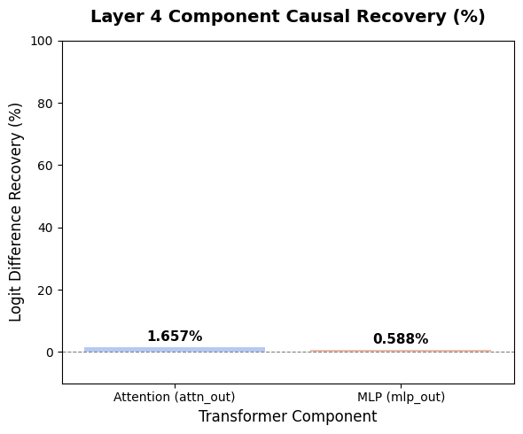
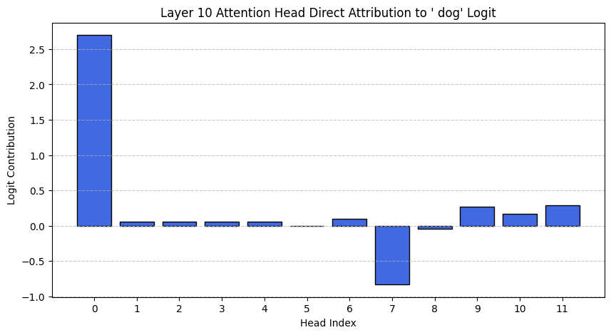
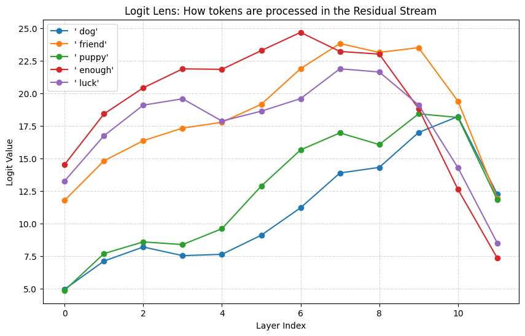

# Activation Patching & Logit Lens on GPT-2

A small mechanistic-interpretability project built with [TransformerLens](https://github.com/TransformerLensOrg/TransformerLens). The repo contains two complementary notebooks: one follows residual-stream information across layers, and the other tests attention-vs-MLP causal recovery at a specific layer.

## Notebooks

### 1. Layer-specific residual patching and logit lens

`notebooks/Activation_Patching_Layer_Specific.ipynb` uses `gpt2-small` and compares a clean prompt (**"My dog is a good"**) against a corrupted prompt (**"My cat is a good"**).

It covers:

1. **Clean / corrupted caches** — `run_with_cache` to record activations and target-token logits.
2. **Layer-specific residual patching** — overwrite `blocks.3.hook_resid_pre` in the corrupted run with the clean activation.
3. **Logit lens** — apply `ln_final` and `W_U` to intermediate residual streams to inspect how token preferences evolve across layers.
4. **Direct head attribution** — project layer-10 head outputs (`hook_z @ W_O`) onto the `' dog'` unembedding direction.

Recorded values from that notebook:

| Quantity | Value |
|---|---:|
| Clean `' dog'` logit | 14.10 |
| Patched `' dog'` logit (layer 3) | 14.10 |
| Layer-10 head 10.0 → `' dog'` | +2.70 |
| Layer-10 head 10.7 → `' dog'` | −0.83 |
| Layer-10 other heads | roughly −0.04 to +0.29 |

At layer 3, the top logit-lens tokens include tokens such as `'enough'`, `' luck'`, and `' friend'`; `' dog'` becomes a stronger candidate later in the network.

### 2. Model pathways: attention vs MLP causal recovery

`notebooks/Activation_Patching_Model_Pathways.ipynb` uses `gpt2-medium` and asks a narrower causal question at **layer 4**:

> When the subject changes from `dog` to `cat`, how much of the clean `dog > cat` preference can be restored by patching only the attention output or only the MLP output at the final token position?

The notebook first verifies that the corruption changes the model's top prediction:

| Prompt | Top prediction | Relevant logit |
|---|---|---:|
| `My dog is a good` | `dog` | `dog`: 13.741 |
| `My cat is a good` | `cat` | `cat`: 15.257 |

It then uses the logit-difference metric:

```text
D = logit(dog) - logit(cat)
```

| Measurement | Value |
|---|---:|
| Clean logit difference | +2.450 |
| Corrupted logit difference | −1.465 |
| Layer 4 attention (`attn_out`) recovery | **1.657%** |
| Layer 4 MLP (`mlp_out`) recovery | **0.588%** |

On this single prompt and intervention, both component-level recoveries are small. Attention recovers more of the clean preference than the MLP, but this is a local diagnostic rather than evidence that attention generally carries more of the relevant information.

## Visuals

### Layer 4 component causal recovery

<p align="center">
  
</p>

This compares normalized logit-difference recovery after patching the layer-4 attention output versus the layer-4 MLP output at the final token position.

### Head contribution

<p align="center">
  
</p>

This highlights the strongest head-level direct contribution to the target-token logit.

### Token processing across layers

<p align="center">
  
</p>

This visualizes how token preferences evolve across layers and helps show where the model begins favoring the final token.

## Known limitations

- These are **small, prompt-level mechanistic probes**, not population-level findings.
- The model-pathways notebook patches only **layer 4** and only the **final token position**; causal effects may be distributed across layers, positions, or interacting components.
- A single-target-logit normalization can become unstable when the clean and corrupted target logits are nearly identical. The second notebook therefore uses the **`dog - cat` logit difference** for the reported recovery numbers.
- Head attribution is a direct-effect approximation; it does not capture all indirect effects through later layers and layer normalization.
- `src/patching_sweep.py` is a draft for a broader layer × position sweep. Verify its outputs before drawing conclusions.

## Getting started

```bash
git clone https://github.com/fahdev789/activation-patching-gpt2.git
cd activation-patching-gpt2

python -m venv .venv
source .venv/bin/activate

pip install -r requirements.txt
jupyter lab
```

Then open either:

- `notebooks/Activation_Patching_Layer_Specific.ipynb`
- `notebooks/Activation_Patching_Model_Pathways.ipynb`

A GPU is helpful for `gpt2-medium`, but the experiments are intentionally small.

To try the draft sweep script:

```bash
python src/patching_sweep.py --clean "My dog is a good" --corrupted "My cat is a good" \
    --answer " dog" --wrong " catcher"
```

## Repo layout

```text
.
├── images/
│   ├── Transformer-Component.png
│   ├── head-contribution.png
│   └── token-processings.png
├── notebooks/
│   ├── Activation_Patching_Layer_Specific.ipynb
│   └── Activation_Patching_Model_Pathways.ipynb
├── src/
│   └── patching_sweep.py
├── requirements.txt
├── LICENSE
└── README.md
```

## References

- Neel Nanda et al., [TransformerLens](https://github.com/TransformerLensOrg/TransformerLens)
- nostalgebraist, [interpreting GPT: the logit lens](https://www.lesswrong.com/posts/AcKRB8wDpdaN6v6ru/interpreting-gpt-the-logit-lens)
- Meng et al., [Locating and Editing Factual Associations in GPT](https://arxiv.org/abs/2202.05262) — causal tracing / activation patching

## License

MIT — see [LICENSE](LICENSE).
