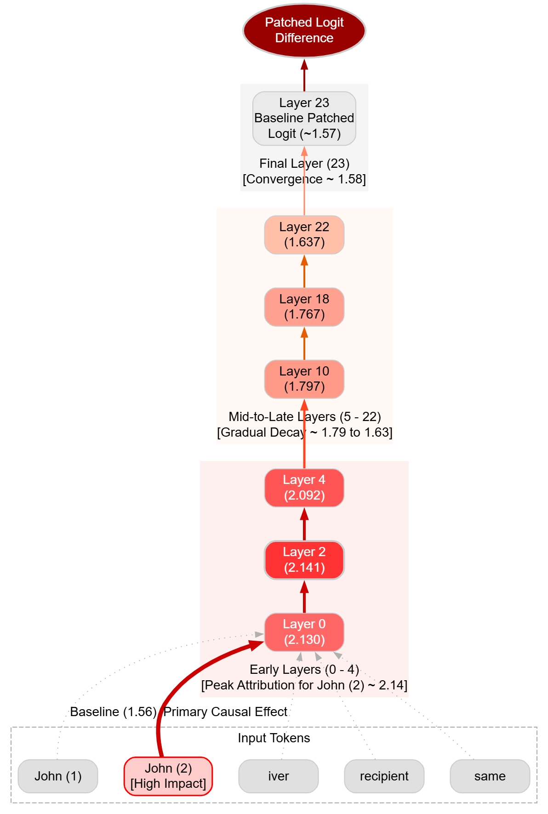
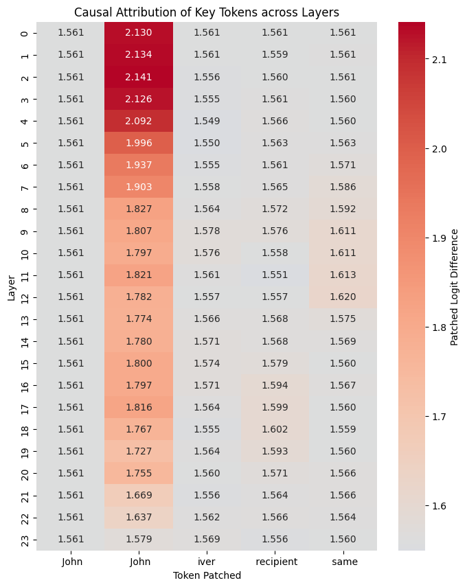

# Finding Duplicate Detector Circuits in GPT-2

This experiment is based on finding the crucial circuits which understands whether the entities in a sentence belongs to single or different. For example, 

`John gave bag to John`

This prompt will help us to understand which circuit of GPT-2 will distinguish the identical entities and how classifies. To investigate it further, I added another line of prompt to test this:

`John gave bag to John: Are the recipient and the giver same?`

Final Tokens: `yes` or `no`  

You can see `second John` has more attention in the Early Layers while `first John` remains constant behavior across all the layers. We can reach out on a question:

_Might be second John took most of the attention of model due to the surrounding tokens. For example, noun, verb and if we tokenize it properly there are 2 distinctions:_

- `"John"` ---> First John doesn't have leading space
- `" John"` --> Second John do possess it

**So we might ask question here, how does model distribute it's attention to other token and which token does possess most of the attention of the model?**
- Is model attending to `gave`?
- Is model attending to `to`?
- Is model attending to `bag`?

To investigate these discoveries, I would recommend to see the following Repo [GPT-2 Identical Circuits](https://github.com/fahdev789/Identical-name-circuit-discovery) which I essentially built to dig deeper into investigation of these model behaviors. Because it is obvious to explore these concepts in order to see the big picture of models.

Please consider the repo as incomplete or unfinished work. In order to have further questions, you can send me email.

